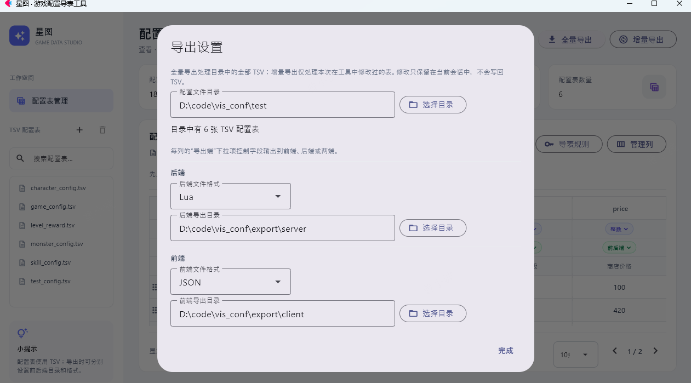

# 星图 · 游戏配置导表工具

用 TSV 管理游戏配置表，支持 Windows 桌面和 Android。

- 分页查看和编辑表格，可添加、删除、拖动和复制数据行。
- 管理列、配置导出规则，并分别生成前后端文件。
- 用小缩略图预览配置表中的本地图片路径。
- 桌面端可使用 AI Agent 生成配置修改预览，并确认后应用。
- 桌面端通过「插件」安装扩展。目录里的插件不会自动生效，安装后点「打开」使用。

## 快速开始

```powershell
python -m pip install -r requirements-desktop.txt
python app.py
```

首次启动需要联网准备 Flet 桌面运行时。Windows 遇到缓存目录重命名权限错误时，程序会短暂重试；如果其他启动进程已准备好缓存，则复用该缓存。

## Windows 分发

构建需要 Windows x64、Python、Flet CLI 和 Inno Setup 6：

```powershell
python -m pip install "flet[cli]>=1.0.0,<2.0.0"
.\build_installer.ps1
```

构建脚本会生成两种分发包：

| 类型 | 产物 | 使用方式 |
|---|---|---|
| 安装版 | `dist/installer/StarMap-Setup-1.0.0.exe` | 安装后从开始菜单启动 |
| 便携版 | `dist/portable/StarMap-Portable-1.0.0.zip` | 解压后运行 `star_map/star_map.exe` |

安装版默认安装到 `%LOCALAPPDATA%\Programs\GameConfigAssistant`。可通过 `.\build_installer.ps1 -Version 1.1.0` 指定版本。

> **签名与安全提示**
>
> 当前安装器和程序未进行代码签名。启用了 Windows 智能应用控制或企业应用控制策略的设备可能会拦截程序。改名、管理员运行或改用 ZIP 都不能单独解除拦截。

### 智能应用控制拦截时

如果你信任该程序，并且只在自己的设备上使用，可按以下步骤继续。关闭智能应用控制会降低设备防护能力，而且设置可能持续生效；公司管理设备请联系管理员。

1. 打开“Windows 安全中心”。
2. 进入“应用和浏览器控制” → “智能应用控制设置”，选择“关闭”。
3. 使用安装版，运行 `dist/installer/StarMap-Setup-1.0.0.exe`；或解压便携版，运行 `star_map/star_map.exe`。
4. 安装版从开始菜单启动“星图 游戏配置导表工具”；便携版直接运行解压后的程序。

Windows 当前不提供只允许单个程序通过智能应用控制的选项。如果设置不可更改，请联系设备管理员，不要尝试绕过组织策略。疑似误报时，可通过 [Microsoft 安全情报文件分析](https://www.microsoft.com/wdsi/filesubmission)提交文件评估；提交不保证解除拦截。

## Android

在 Windows 上构建 APK（首次构建需要联网；Flet CLI 会准备所需工具链）：

```powershell
python -m pip install "flet[cli]>=1.0.0,<2.0.0"
flet build apk --module-name app --project game-config-assistant --org com.literwave --product "星图"
```

产物位于 `build/apk/`。在应用的“导出设置”中选择手机上的 TSV；导出时通过系统保存对话框生成 ZIP，包含 `backend/` 和 `frontend/` 文件夹。手机上的编辑仅保留在当前会话，不会覆盖原文件。

## 示例：使用 test 配置表

仓库的 `test/` 目录包含道具、角色、技能、怪物和等级奖励配置表。



1. 点击“导出设置”，在“配置文件目录”选择 `test/`。
2. 从左侧配置表列表打开 `test_config.tsv`。它包含 `id`、`name` 和 `icon_path` 三列；图标列会显示小缩略图，点击后可编辑原始路径。
3. 点击“导表规则”设置 key，点击“管理列”添加或调整字段。
4. 选择后端/前端格式和导出目录，再点击“全量导出”或“增量导出”。

`test/test_config.tsv` 的图片路径为 `../assets/assistant-icon.png`，以 TSV 文件所在目录为基准。`export/client/` 和 `export/server/` 是前后端导出目录示例。

## 常用操作

| 操作 | 说明 |
|---|---|
| 搜索配置表 | 文件名模糊筛选，不区分大小写；例如 `skcf` 可匹配 `skill_config.tsv`。列表左侧的字母可以跳到对应拼写开头的表 |
| 新建/删除/刷新配置表 | 列表标题旁的 `+` 新建，刷新图标重新读取目录；删除前会确认。桌面端操作所选目录中的文件 |
| 编辑单元格 | 点击单元格修改数据，点「保存」后写回当前 TSV，并更新已配置的前后端文件。第一行字段名、类型、导出端和注释也可以点击修改；编辑窗口右上角 `×` 可关闭，对话框里还没保存的修改会丢弃 |
| 管理列 | 添加列时可设置名称、类型、导出端、注释和默认值；删除列会移除该列数据并请求确认 |
| 移动行 | 拖动行首手柄调整顺序 |
| 复制并插入行 | 选中源行后按 `Ctrl+C`，再选目标行并按 `Ctrl+V`；副本插入目标行之前，不覆盖数据 |
| 撤销 | 按 `Ctrl+Z` 撤销最近一次编辑、行排序、复制、新增或删除，最多保留 50 步 |
| 分页 | 可选择每页显示 10、20、50 或 100 行；新增行会追加到表格末尾并跳转到所在页 |
| AI Agent（桌面端，可选） | 在「插件」里安装并打开。打开对话时停在最新一条。点「隐藏」后窗口收起，请求继续在后台运行。Cursor 在配置目录里直接读改文件，结束后重新读取当前表 |
| 插件（桌面端） | 顶部「插件」。安装、更新、打开、卸载都在这个窗口里 |

复制粘贴快捷键使用应用内行剪贴板，不会替代系统文本剪贴板。桌面端修改单元格、行列或导出端后会写回 TSV，并更新已配置的前后端文件。手机上的编辑仍只留在当前会话，不会覆盖原文件。安装了 AI Agent 插件后，Cursor 会在配置目录里自己改文件，星图再重新读取当前表。

### 配置 Cursor

星图的 AI Agent 是可选插件。安装后可以选 Cursor、OpenAI 或 DeepSeek，在当前配置目录里阅读和修改文件。Cursor 用本机 CLI 的登录状态。OpenAI 和 DeepSeek 的 API Key 只写入系统凭据库，不写入 `settings.json`。Android 没有这项功能。

#### 1. 安装并登录 CLI

1. 打开 **PowerShell**，运行 Cursor 官方安装命令：

   ```powershell
   irm 'https://cursor.com/install?win32=true' | iex
   ```

   如果不想执行安装脚本，到 [Cursor CLI 官方文档](https://cursor.com/docs/cli)看当前的安装方式。

2. **关掉这个 PowerShell，再开一个**，确认命令可用：

   ```powershell
   agent --version
   ```

3. 运行 `agent`，按提示在浏览器里登录 Cursor 账号。登录完成后可以退出 CLI。
4. 星图如果在安装或登录之前就开着，先完全退出，再重新运行 `python app.py`，否则它读不到更新后的 PATH。

PowerShell 里 `agent --version` 也找不到命令时，按官方文档检查安装目录是否在用户 PATH 里，改完后再重启星图。确认命令时写成 `agent --version`（两个短横线）。

星图提示「未找到 Cursor Agent CLI」时，多半是星图在安装 CLI 之前就启动了，进程里的 PATH 还是旧的。先完全退出星图，再从新开的 PowerShell 里运行 `agent --version`。能打出版本号后，在同一个窗口里运行 `python app.py`。

#### 重装 CLI

只卸命令行。不要删 Cursor 编辑器，也不要删 `%USERPROFILE%\.cursor`，登录和编辑器设置都在那里。在 PowerShell 里运行：

```powershell
Get-CimInstance Win32_Process |
  Where-Object { $_.ExecutablePath -like '*cursor-agent*' } |
  ForEach-Object { Stop-Process -Id $_.ProcessId -Force }

Remove-Item -Recurse -Force "$env:LOCALAPPDATA\cursor-agent"
Remove-Item -Recurse -Force "$env:LOCALAPPDATA\cursor-compile-cache" -ErrorAction SilentlyContinue

$removed = Join-Path $env:LOCALAPPDATA "cursor-agent"
$userPath = [Environment]::GetEnvironmentVariable("Path", "User")
$filtered = (
  $userPath -split ';' |
    Where-Object { $_ -and ($_.TrimEnd('\') -ne $removed.TrimEnd('\')) }
) -join ';'
[Environment]::SetEnvironmentVariable("Path", $filtered, "User")
```

然后新开一个 PowerShell，重新安装并确认：

```powershell
irm 'https://cursor.com/install?win32=true' | iex
```

关掉这个窗口，再开一个，运行 `agent --version`。能打出版本号后，在同一个窗口里进入工具目录并运行 `python app.py`。

#### 2. 在星图里选择模式

1. 在导出设置里选好配置文件目录，并打开要处理的表。
2. 点顶部「插件」，安装「AI Agent」后点「打开」。不安装就没有这项。
3. 右上角齿轮里选择模型服务：Cursor、OpenAI 或 DeepSeek。Agent 可以改配置目录里的文件，Ask 只读。Cursor 的模型可以留空。OpenAI 默认 `gpt-4o-mini`，DeepSeek 默认 `deepseek-chat`。
4. 在对话里直接说要做什么。结束后星图会重新读取当前打开的表。对话上方可以新建、切换和删除多段对话，关掉窗口后再打开还在。

> Agent 模式会改配置目录里的文件。Cursor 还会让 CLI 执行本机命令。只在信任这次请求时使用。

## 插件

插件放在 `plugin_catalog/`，启动时不会自动加载。点顶部「插件」：

| 状态 | 操作 |
|---|---|
| 未安装 | 安装 |
| 已安装 | 打开、卸载 |
| 有新版本 | 先更新，再打开 |

安装后的副本在：

```text
%APPDATA%\GameConfigAssistant\plugins
```

改了 `plugin_catalog` 里的插件后，重新运行 `python app.py`。列表显示「有新版本」时点「更新」，再点「打开」。

自己写插件时，在 `plugin_catalog` 放一个 `.py`，提供 `register(ctx)` 并返回动作列表。界面只通过 `ctx` 调用，不直接改星图窗口。

### 协议

随仓库提供的协议插件用来编辑 `.proto`，并导出 `.pb`、C# 和协议号。

1. 安装并打开「协议」。
2. 标题旁的齿轮设置两个目录：proto 导入目录是正在编辑的 `.proto`，pb 导出目录是生成的 `.pb`，默认是仓库的 `pb`。
3. 左侧搜索文件，中间搜索协议。输入后回车打开匹配项。焦点在搜索框里时，上下键只移动当前列表的选择。
4. 可以新增或删除 proto 文件、协议和字段。字段结构可以是单个值、数组或字典。点「结构」格子，在字段表上方选择。数组写成 `repeated`，字典写成 `map<键, 值>`，键和值都直接输入并模糊匹配。值右边点一下，在「单个」和「数组」之间切换；选数组时会额外生成一个只含 `repeated` 字段的类型，再作为 `map` 的值。键只能是整数、`bool` 或 `string`。字段类型可以直接输入。输入时，字段表上方会按模糊匹配列出标量、当前文件和 `import` 进来的消息，点一下就能使用；只剩一个匹配时按回车补全。保存或导出时，这些范围里没有的类型会报错。左侧协议列表按名字前缀打标签：`c2s` 是请求，`s2c` 是返回，`notify` 是推送，其它名字是结构，同一个文件里可以混着写。只有 `common.proto` 里的名字不能以 `c2s` 或 `s2c` 开头。保存时，同一协议里的字段注释会自动对齐。
5. 按 `Ctrl+S` 或点「保存」保存当前文件。点底部「源码」可以直接编辑整个 `.proto` 文本，点「表格」切回时会重新解析。表格解析不了的文件（例如含 `enum`、`oneof`）会直接打开源码。
6. 点「导出协议」。`.pb` 写到 pb 导出目录，C# 写到 `ptotools/proto/outcs`。协议号同时生成两份：客户端 `client/net_pb.json`，后端 `server/net_pb.lua`。源 `.proto` 只保留在仓库的 `proto/`。只给 `c2s`、`s2c`、`notify` 开头的协议编号，`common.proto` 和结构类型不编号。文件按名字排序，同一文件里按出现顺序，编号从 1 递增。客户端 JSON 和后端 Lua 都按包写入 `define`，协议名用短名。后端还会生成 `ID_TO_PACK_NAME`、`PTONAME_TO_ID`、`PACK_NAME_TO_ID`、`ID_TO_PTONAME`、`for_maker` 和 `for_caller`。不同文件里的同名协议会带上包名，例如 `Login.s2c_user_create` 和 `User.s2c_user_create`；没有包名时用文件名。同一个包里协议名相同才会失败。

导出结果写在底部状态里。文字过长时会省略，鼠标放上去可以看到完整路径。「保存」和「导出协议」固定在右侧。

## TSV 格式与导出

每个 TSV 使用 UTF-8 编码，前四行为表格元数据：

| 行 | 内容 |
|---|---|
| 第 1 行 | 字段名 |
| 第 2 行 | 数据类型 |
| 第 3 行 | 导出端 |
| 第 4 行 | 字段注释 |
| 第 5 行起 | 数据 |

支持字符串、整数、小数、布尔值、JSON、Lua 表数组和 Lua 表字典。导出端可设为后端、前端或两端；默认后端 Lua、前端 JSON。

空单元格以及嵌套数据中的 `null`/`nil` 会在导出时省略；数组中的空值也会移除，因此后续元素会前移。Key 为空仍会报错。

“全量导出”处理配置目录中的全部 TSV，并删除导出目录里已经没有对应配置表的同格式文件。“增量导出”只列出本次会话修改过的表，默认全选，不会删除其它文件。未选中的表保留在队列中，导出成功的表才会移出队列。导出设置里可以直接粘贴目录；点「保存」时，不存在的目录会在窗口里写出具体错误。

导表规则默认使用 `id`（存在时）。多个 key 按列顺序嵌套，例如 `[key1][key2]`；不选择 key 时导出记录数组。Key 为空、重复或未勾选对应导出端时会报错。前后端若生成相同路径，工具会停止导出并提示冲突。

设置的目录（含 UI 配置目录）、文件格式和各表 key 规则会自动保存：

```text
%APPDATA%\GameConfigAssistant\settings.json
```

更多输入语法和导出细节：

<details>
<summary>展开查看 Lua 表、图片预览和导出文件说明</summary>

- Lua 数组示例：`{1, 2, "three"}`。
- Lua 字典示例：`{id = 1, name = "道具"}` 或 `{["id"] = 1}`。支持嵌套表及 `true`、`false`、`nil`；不会执行 Lua 代码。
- JSON 导出时 Lua 表会转换为数组或对象。Lua 导出采用多行缩进格式；TSV 单元格内的 Lua 表值保持单行。
- 字符串字段填写本地 PNG、JPG、JPEG、GIF、WEBP 或 BMP 路径时显示缩略图。相对路径以 TSV 所在目录为基准；点击缩略图可查看或编辑路径。
- 「导出设置」里的「UI 配置目录」用来显示资源路径图标。目录例如 `D:\code\game_demo_client\assets\resources\ui`，单元格为 `ui/item_icons/speed_up` 时，显示该目录下的 `item_icons\speed_up.png`。扩展名可以省略，末尾的 `/spriteFrame` 会去掉。路径以配置目录名为前缀时会去掉这一段，其余部分在 UI 目录内查找。
- 导出文件名使用 `<配置表名>.lua` 或 `<配置表名>.json`，前后端通过各自目录区分。未启用对应导出端的列不会写入该端文件。
- Lua 文件头会标注作者 `liter_wave`、生成工具及来源 TSV 文件名。
- 导出完成后会显示处理表数量、生成文件数量和每张表的输出路径。

</details>
